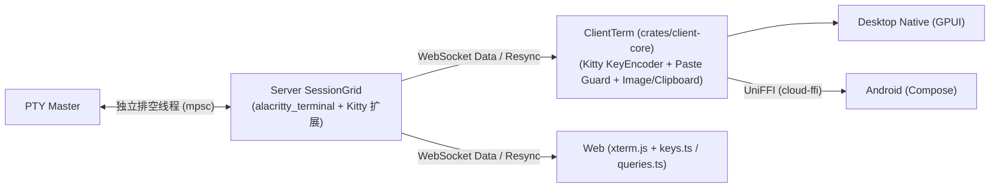

# Octoterm (Gateterm) 纯 Rust Kitty 协议生态与终端内核增强设计

日期: 2026-10-30
状态: 草案 (待评审)

## 1. 背景与意图 (Intent & Why)

随着现代 TUI 应用（如 Neovim、Helix、Fish、Yazi）以及 AI Coding Agent（Claude Code、Codex、OpenCode、pi、Antigravity）的演进，以 **Kitty 协议家族**（Kitty Keyboard Protocol `CSI ... u`、Kitty Clipboard Protocol `OSC 5522`、Kitty Graphics Protocol `APC G`）为代表的现代终端扩展已成为事实标准。

目前 Octoterm 的终端层基于纯 Rust 的 `alacritty_terminal 0.25`（服务端 `SessionGrid`、Desktop Native、Android `ClientTerm`）与 Web 端的 `xterm.js`，存在以下痛点：
1. **`alacritty_terminal` 内置的 Kitty 能力未开启**：`alacritty_terminal 0.25` 原生已实现 Kitty 键盘协议状态机（`CSI ? u` 应答、主/副屏模式栈、`TermMode::KITTY_KEYBOARD_PROTOCOL`）、`OSC 52` 剪贴板、花式下划线（`UNDERCURL` 等）和 `OSC 8` 超链接，但因 `Config::default().kitty_keyboard` 默认为 `false` 且 `ClientTerm` 使用了 `VoidListener`，导致这些能力处于休眠或丢弃状态。
2. **键盘编码散落在三端**：Web（`keys.ts`）、Desktop Native（`input.rs`）、Android（`TerminalKeyboard.kt`）各自维护一套键盘编码逻辑，且均未实现 Kitty `CSI ... u` 编码，使得终端内程序探测不到 Kitty 键盘支持而只能降级到 `modifyOtherKeys`（`CSI 27;mod;code~`）。
3. **剪贴板与粘贴安全缺失**：未接通 `OSC 52` 远端复制，不支持向多模态 AI Agent 粘贴富格式/图片的 Kitty `OSC 5522`；同时 `ClientTerm::encode_paste` 未过滤 `\x1b[201~` 括号粘贴逃逸序列，且在未开启 Bracketed Paste 的程序中粘贴含 `\r`/`\n` 文本时缺少行结束符拦截保护。
4. **macOS PTY 读取截断与同步解析阻塞**：服务端 `pty.rs` 在同一个阻塞读线程中读取 PTY 并立即加锁执行 `grid.advance()`，在 macOS 内核每次 `read()` 截断至约 1 KiB 的特性下会导致高频锁争用与子进程写阻塞。

本设计的意图是在 **100% 保持纯正 Rust 原生生态（不引入 Zig / `libghostty` 外部工具链）** 的前提下，彻底激活 `alacritty_terminal` 的内置能力，并在 `crates/client-core` 与 `crates/server` 中构建统一的纯 Rust Kitty 协议生态层。

---

## 2. 目标、非目标与反目标 (Goals, Non-Goals, Anti-Goals)

### 目标 (Goals)
1. **全端支持 Kitty 键盘协议 (`CSI ... u`) 并收拢编码器**：
   - 开启服务端与客户端 `alacritty_terminal` 的 `kitty_keyboard: true`，支持 `CSI ? u` 查询应答、主/副屏模式栈及 `resync` 重绘恢复。
   - 将键盘编码器（按 `win32-input-mode` $\rightarrow$ `Kitty CSI-u` $\rightarrow$ `modifyOtherKeys` $\rightarrow$ `Legacy VT` 优先级）统一收拢至纯 Rust 的 `crates/client-core`，供 Desktop Native 直接调用、Android 通过 UniFFI 调用，并在 Web 端 `keys.ts` 与 `queries.ts` 中 1:1 同步。
2. **打通 `OSC 52` 与 Kitty `OSC 5522` 剪贴板协议**：
   - 接通 `OSC 52` 远端写剪贴板能力。
   - 用纯 Rust 实现 Kitty `OSC 5522` 剪贴板协议（含 `DECSET 5522` 粘贴事件通知），支持多 MIME 格式（如 `image/png`、`text/plain`、`text/html`）读写，遵循“写入默认允许（上限 64 MiB）、读取需用户授权”的安全模型。
3. **加固粘贴安全与终端危险序列边界**：
   - 清洗括号粘贴中的 `\x1b[201~` 逃逸序列。
   - 对未开启 `BRACKETED_PASTE` 时包含 `\r` 或 `\n` 的粘贴提供显式安全检测与确认机制。
4. **解耦服务端 PTY 排空与 VT 解析，暴露富文本属性**：
   - 将 `crates/server/src/session/pty.rs` 的 PTY 阻塞读取与 `SessionGrid::advance` 解耦为双线程/管道模型。
   - 在 `ClientCell` 与 `SessionGrid::repaint` 中完整保留花式下划线（双线、波浪线 `UNDERCURL`、点线、虚线）及 `OSC 8` 超链接。
5. **纯 Rust 扩展 Kitty 图形协议 (`APC G` / `\x1b_G...`)**：
   - 在纯 Rust 字节流预解析层实现 Kitty Graphics Protocol 核心子集（静态与多帧图片传输、网格锚点定位、随滚动区域滚动、错误响应返回以防客户端挂起），向 Desktop Native、Android 和 Web 渲染层提供图片图层。

### 非目标 (Non-Goals)
- **不替换 `alacritty_terminal` 或 `xterm.js`**：继续以 `alacritty_terminal` 作为 Rust 侧 VT 网格内核，Web 端继续使用 `xterm.js`（不引入 WASM 编译链）。
- **不实现 Sixel 或 iTerm2 (`OSC 1337`) 专有图片协议**：图形协议统一聚焦于事实标准的 Kitty Graphics Protocol。

### 反目标 (Anti-Goals)
- **绝不引入 Zig / C++ 等非 Rust 原生构建依赖**：所有新增协议解析与编码必须为 100% 纯 Rust 实现，确保 `cargo build` 与现有 Android NDK / Windows MSVC 编译流程零额外工具链负担。
- **绝不破坏 Windows ConPTY 兼容性与 `gateterm` 线协议向后兼容**：Windows 11+ 的 `win32-input-mode` 优先级保持最高；所有线协议遵守 `docs/protocol.md` 的 `X4` 规则（不 bump `PROTO_VERSION = 1`）。

---

## 3. 约束条件 (Constraints)

1. **查询只由服务端应答（协议规则 `D7`）**：
   - `CSI ? u`（Kitty 键盘模式查询）与 `APC G`（Kitty 图形传输应答）必须**仅由服务端 `SessionGrid` 应答并写回 PTY**。
   - 客户端（尤其是 Web 端 `xterm.js`）必须静默拦截这些查询，绝不能从客户端绕网络写回 PTY。
2. **重连与 `resync` 状态自洽（协议规则 `S5` / `S10`）**：
   - 当客户端触发 `resync` 时，服务端 `SessionGrid::repaint()` 合成的 ANSI 字节流必须恢复当前活跃的 Kitty 键盘协议标志位（`\x1b[>{flags}u`）以及 `DECSET 5522` 模式，使重连后的客户端与服务端状态严格一致。
3. **二进制单元格快照向后兼容**：
   - `crates/client-core/src/term.rs` 中的 `PACKED_CELL_BYTES = 20` 布局被 Desktop Native 与 Android（`AlacrittyTerm.kt`）紧耦合使用。新增下划线样式属性应复用现有的 `attrs: u16` 高位保留位（目前仅使用了低 7 位 `1..=64`），避免改动 20 字节定长步幅；超链接与图片图层通过独立的方法暴露。

---

## 4. 候选方案与选型 (Approaches)

在设计阶段评估了以下三种方案，最终选定 **方案一**：

| 方案 | 核心思路 | 优势 | 劣势 / 放弃原因 |
| :--- | :--- | :--- | :--- |
| **方案一（选定）** | **激活 `alacritty_terminal` 内置能力 + 在 `client-core` / `server` 扩展纯 Rust Kitty 模块** | 100% 纯 Rust 零外部工具链依赖；复用 `alacritty_terminal` 现成的 Kitty 键盘栈与 `OSC 52`；Web 端构建零变更 | Web 端的 `keys.ts` 需用 TS 同步实现一份 `CSI u` 编码分支 |
| **方案二** | 在方案一基础上，将 `client-core` 编译为 WASM 供 Web 端调用 | Web 端也能复用同一份 Rust 键盘编码代码 | 需在 `build-frontend` 中引入 `wasm-pack` 与 `wasm32-unknown-unknown` 工具链 |
| **方案三** | 替换为 Zig 编写的 `libghostty` 或 WezTerm 的 `wezterm-term` | 上游自带完整图形协议 | `libghostty` 破坏纯 Rust 生态并强制依赖 Zig；`wezterm-term` 依赖树极其庞大且未独立发布 |

---

## 5. 架构与详细技术方案 (Detailed Technical Design)

整体改造按依赖关系划分为四个阶段（Phase 1 至 Phase 4），每个阶段均可独立编译、测试与验收。



### Phase 1：Kitty 键盘协议 (`CSI ... u`) 与纯 Rust 统一键盘编码器

#### 1.1 激活 `alacritty_terminal` 的 Kitty 键盘状态机
- **修改位置**：[`crates/server/src/session/grid.rs`](file:///D:/online/Octoterm/crates/server/src/session/grid.rs)、[`crates/client-core/src/term.rs`](file:///D:/online/Octoterm/crates/client-core/src/term.rs)
- **配置开启**：在 `SessionGrid::new`、`ClientTerm::new`、`ClientTerm::reset`、`ClientTerm::set_max_scrollback` 中创建 `alacritty_terminal::term::Config` 时，显式设置 **`kitty_keyboard: true`**。
- **状态提取**：从 `self.term.mode()` 提取 `TermMode::KITTY_KEYBOARD_PROTOCOL` 对应的 5 个位标志，打包为 `kitty_keyboard_flags: u8`：
  - Bit 0 (`1`): `TermMode::DISAMBIGUATE_ESC_CODES`
  - Bit 1 (`2`): `TermMode::REPORT_EVENT_TYPES`
  - Bit 2 (`4`): `TermMode::REPORT_ALTERNATE_KEYS`
  - Bit 3 (`8`): `TermMode::REPORT_ALL_KEYS_AS_ESC`
  - Bit 4 (`16`): `TermMode::REPORT_ASSOCIATED_TEXT`
- **暴露给客户端与 FFI**：
  - 在 `ClientTermState`（`crates/client-core/src/term.rs`）和 `TermState`（`crates/cloud-ffi/src/lib.rs`）中新增字段 `pub kitty_keyboard_flags: u8`。
- **`resync` 重绘恢复**：
  - 在 `SessionGrid::repaint()` 尾部（紧随 `modify_other_keys` 恢复之后），若当前 `kitty_keyboard_flags != 0`，先输出 `\x1b[<u` 清空可能残留的旧栈顶，再输出 `\x1b[>{kitty_keyboard_flags}u`（或在客户端 `reset()` 已清空栈的前提下直接输出 `\x1b[>{kitty_keyboard_flags}u`），使重连后的客户端与服务端状态一致。
- **Web 端查询拦截与状态跟踪**：
  - 在 [`clients/web/src/queries.ts`](file:///D:/online/Octoterm/clients/web/src/queries.ts) 的 `swallowTerminalQueries` 中注册 `parser.registerCsiHandler({ prefix: "?", final: "u" }, swallow)`，防止未来 `xterm.js` 插件重复应答 `CSI ? u`。
  - 在 [`clients/web/src/main.ts`](file:///D:/online/Octoterm/clients/web/src/main.ts) 中通过 `parser.registerCsiHandler` 监听 `CSI > flags u`（push）、`CSI < count u`（pop）、`CSI = flags ; mode u`（set）以及 `ALT_SCREEN` 切换，驱动 `KeyboardAdapter.setKittyFlags(flags)`。

#### 1.2 纯 Rust 统一键盘编码器 (`crates/client-core/src/keyboard.rs`)
在 `crates/client-core` 中新增 `keyboard` 模块，将原本分散在 `clients/desktop-native/src/terminal/input.rs` 与 `clients/android/.../TerminalKeyboard.kt` 的编码逻辑统一收拢：

- **输入模型**：
  ```rust
  #[derive(Debug, Clone, Copy, PartialEq, Eq)]
  pub enum KeyEventKind {
      Press,
      Repeat,
      Release,
  }

  #[derive(Debug, Clone, PartialEq, Eq)]
  pub struct KeyInput {
      pub key: String,              // 归一化键名: "enter", "tab", "backspace", "escape", "up", "a", "f1", ...
      pub codepoint: Option<u32>,   // 关联字符码点
      pub shifted_codepoint: Option<u32>, // Shift 状态下的备用码点 (用于 REPORT_ALTERNATE_KEYS)
      pub base_layout_codepoint: Option<u32>, // 物理按键对应的标准 PC-101 布局码点
      pub shift: bool,
      pub alt: bool,
      pub ctrl: bool,
      pub super_key: bool,
      pub kind: KeyEventKind,
  }
  ```
- **编码优先级流水线 (`encode_key`)**：
  1. **Windows 11+ ConPTY `win32-input-mode`**（当 `server_os == "windows" && win32_input_mode` 时）：保持现有 `CSI Vk;Sc;Uc;Kd;Cs;Rc _` 编码不变。
  2. **Kitty 键盘协议 `CSI ... u`**（当 `term_state.kitty_keyboard_flags > 0` 时）：
     - 若 `kind == KeyEventKind::Release` 且未开启 `REPORT_EVENT_TYPES (2)`，忽略并返回空字节。
     - 根据 `DISAMBIGUATE_ESC_CODES (1)`、`REPORT_EVENT_TYPES (2)`、`REPORT_ALTERNATE_KEYS (4)`、`REPORT_ALL_KEYS_AS_ESC (8)`、`REPORT_ASSOCIATED_TEXT (16)` 严格按 Kitty 规范生成 `CSI unicode-key-code[:shifted[:base]] ; modifiers[:event-type] [; text-as-codepoints] u`（方向键/功能键在带修饰键或事件类型时同样携带对应 `:event-type`）。
  3. **xterm `modifyOtherKeys`**（当 `term_state.modify_other_keys > 0` 时）：保持现有 `Enter` / `Tab` / `Backspace` / `Escape` 的 `CSI 27;mod;code~` 编码。
  4. **传统 VT 编码（Legacy VT）**：仅在 `Press` / `Repeat` 时生成标准 VT 序列。
- **各端接入**：
  - **Desktop Native**：`clients/desktop-native/src/terminal/input.rs` 保留 GUI 工作台快捷键过滤（`is_workbench_or_clipboard_shortcut`），终端按键编码直接委托给 `gateterm_client_core::keyboard::encode_key`。
  - **Android**：在 `crates/cloud-ffi/src/lib.rs` 的 `TermEngine` 上暴露 `encode_key(...) -> Vec<u8>`，`TerminalKeyboard.kt` 精简为按住状态跟踪与调用 FFI。
  - **Web**：在 `clients/web/src/keys.ts` 中新增与 `client-core::keyboard` 1:1 对齐的 Kitty `CSI u` 编码分支。

---

### Phase 2：剪贴板协议 (`OSC 52` + Kitty `OSC 5522`) 与粘贴安全加固

#### 2.1 粘贴安全加固（修复 Bracketed Paste 逃逸与非括号粘贴 `\r` 直发风险）
- **过滤恶意逃逸序列**：
  - 修改 `ClientTerm::encode_paste(&self, text: &str)`（以及 Web 端粘贴路径）：在包裹 `\x1b[200~...\x1b[201~` 前，先将文本中出现的任何 `\x1b[200~` 与 `\x1b[201~`（或裸 `ESC` `\x1b`）剥离，彻底杜绝恶意文本伪造 `\x1b[201~` 逃逸出括号粘贴后直接执行命令。
- **非 Bracketed Paste 多行粘贴检测**：
  - 在 `ClientTerm` 上新增 `pub fn paste_requires_confirmation(&self, text: &str) -> bool`：当 `!self.term.mode().contains(TermMode::BRACKETED_PASTE)` 且 `text` 包含 `\r` 或 `\n` 时返回 `true`（同时暴露到 `TermEngine` FFI）。
  - Desktop Native、Android 与 Web 端在粘贴前调用该检查：若返回 `true`，弹出确认提示（展示即将粘贴的行数/内容摘要），用户确认后再调用 `encode_paste` 发送。

#### 2.2 打通 `OSC 52` 与扩展纯 Rust Kitty `OSC 5522` 剪贴板协议
- **接通 `OSC 52`（文本剪贴板）**：
  - 将 `ClientTerm` 中的 `Term<VoidListener>` 替换为 `Term<ClientEventListener>`，捕获 `Event::ClipboardStore(ClipboardType, String)` 并存入 `ClientTerm` 的待消费队列（提供 `drain_clipboard_events(&mut self) -> Vec<ClipboardEvent>`，同步暴露到 `TermEngine` FFI）。
  - 在 `SessionGrid` 中，由于 `OSC 52` 写入目标是客户端本地剪贴板，原始字节流已通过数据通道（`D1`）发往所有连接的客户端，服务端无需攔截 `OSC 52` 写操作。
- **纯 Rust Kitty `OSC 5522` 与 `DECSET 5522` 剪贴板协议**：
  - 在 `crates/client-core/src/clipboard.rs` 中实现 `OSC 5522` 解析器与编码器：
    - 支持 `type=write` / `type=wdata`（终端内程序向客户端剪贴板写入多 MIME 格式数据，如 `text/plain`、`text/html`、`image/png`），单次写入上限默认 **64 MiB**（`MAX_CLIPBOARD_WRITE_BYTES = 64 * 1024 * 1024`），超限丢弃并保持原剪贴板不变。
    - 支持 `type=read`（终端内程序请求读取客户端剪贴板可用 MIME 列表或指定 MIME 数据）：客户端收到后触发 UI 权限确认弹窗（包含文本/图片预览），用户批准后将对应的 `OSC 5522` 数据包写回当前会话通道。
    - 支持 `DECSET 5522`（`\x1b[?5522h` / `\x1b[?5522l`）：当终端内程序（如支持贴图的 AI Agent）开启该模式且用户触发粘贴时，客户端发送 `OSC 5522` 粘贴事件告知当前系统剪贴板中包含的 MIME 类型列表（如 `image/png`、`text/plain`），由程序按需拉取图片或文本。

---

### Phase 3：服务端 PTY 读取/解析解耦与富单元格属性 (`UNDERCURL`、`OSC 8`)

#### 3.1 服务端 PTY 读取排空与 VT 解析并发解耦
- **修改位置**：[`crates/server/src/session/pty.rs`](file:///D:/online/Octoterm/crates/server/src/session/pty.rs)
- **双线程流水线设计**：
  1. **PTY 排空线程（Drain Thread）**：只做一件事——循环调用 `reader.read(&mut buf)`，将读到的字节切片立即送入有界通道 `std::sync::mpsc::sync_channel::<Vec<u8>>(256)`（单块最大 64 KiB），**绝不加 `s.shared` 锁，也绝不执行 VT 解析**。即使 macOS 内核将每次 `read` 截断为 1 KiB，排空线程也能在微秒级内连续排空内核缓冲区，子进程写端永不因 VT 解析而阻塞。
  2. **VT 解析与广播线程（Parser Thread）**：从 `mpsc` 通道阻塞接收第一块数据后，调用 `try_recv()` 将当前通道中积压的后续分块一次性合并（上限 `64 KiB`），然后**仅加一次 `s.shared.lock()`** 完成 `grid.advance(&batch)`、`buffer.append(&batch)` 和 `take_pty_replies()`，释放锁后写回查询应答并向 WebSocket 广播 `SessionOutput::Data`。

#### 3.2 花式下划线与 `OSC 8` 超链接透传
- **扩展 `ClientCell::attrs` 位标志（保持 20 字节 `PACKED_CELL_BYTES` 不变）**：
  - 在 `crates/client-core/src/term.rs` 的 `pub mod attr` 中利用高比特位新增细分下划线标志（同时保留 `UNDERLINE = 8` 供不区分样式的旧调用方兼容，或由渲染层按具体样式绘制）：
    - `pub const DOUBLE_UNDERLINE: u16 = 128;` (`1 << 7`)
    - `pub const UNDERCURL: u16 = 256;` (`1 << 8`)
    - `pub const DOTTED_UNDERLINE: u16 = 512;` (`1 << 9`)
    - `pub const DASHED_UNDERLINE: u16 = 1024;` (`1 << 10`)
    - `pub const HYPERLINK: u16 = 2048;` (`1 << 11`)
  - 在 `SessionGrid::sgr_string` 中分别输出 `4:2`（双线）、`4:3`（波浪线）、`4:4`（点线）、`4:5`（虚线），保证 `resync` 重绘不丢失花式下划线。
- **暴露 `OSC 8` 超链接查询**：
  - 在 `ClientTerm` 与 `TermEngine`（FFI）上新增 `pub fn hyperlink_at(&self, col: usize, row: usize) -> Option<String>`，读取当前视口对应单元格上的 `cell.hyperlink().map(|h| h.uri().to_string())`。
  - 点击超链接时执行安全校验：仅允许 `http://`、`https://`、`mailto:` 直接调用系统浏览器打开，拦截 `file://`、控制字符路径或未知自定义 URL scheme（对应 Ghostty 安全公告 `GHSA-cw69-wm67-5pv8`）。

---

### Phase 4：纯 Rust Kitty 图形协议 (`APC G` / `\x1b_G...`)

- **设计位置**：新增 `crates/client-core/src/graphics.rs`，在 `SessionGrid` 与 `ClientTerm` 中共用。
- **协议解析与安全边界**：
  - 扩展现有的字节流过滤器（`CsiColonFilter` 升级为 `VtStreamFilter`），识别 APC 序列 `\x1b_G<control_data>;<base64_payload>\x1b\\`（支持分块传输 `m=1` / `m=0`）。
  - **仅支持直接传输模式（`t=d`）**：为防范 Ghostty 安全公告 `GHSA-mhff-mv4q-fp63`（通过 `t=f` / `t=t` 读取或删除宿主机临时目录外的文件），对于远程/多端架构，**拒绝 `t=f`（本地文件路径）和 `t=t`（临时文件）传输方式**，一律返回 `EINVAL:file transmission disabled`，仅允许通过终端字节流内联传输（`t=d`，支持 `f=100` PNG、`f=32` RGBA、`f=24` RGB 及 `o=z` zlib 压缩）。
  - **内存配额与错误应答**：每个会话图片缓存上限设为 **32 MiB**（超出时按 LRU 淘汰最旧的未显示图片）；单张图片最大尺寸限制为 `4096 × 4096`。当收到损坏的图片数据或非法参数且未设置 `q=2`（静默）时，服务端 `SessionGrid` 生成标准错误响应 `\x1b_Gi=<id>;EINVAL:<reason>\x1b\\` 放入 `pty_replies` 写回 PTY，防止 `kitten icat` 等客户端挂起等待。
- **网格锚点与客户端渲染**：
  - 当收到显示/放置命令（`a=T` 或 `a=p`）时，记录 `ImagePlacement { image_id, placement_id, abs_line, col, cols, rows, z_index }`，随文本滚动同步更新可见行坐标。
  - `ClientTerm` 暴露 `pub fn visible_images(&self) -> Vec<ViewportImage>`（包含 RGBA 像素或 PNG 字节及视口内 `(col, row, width_cells, height_cells)`），供 Desktop Native（`TerminalElement`）和 Android（`TerminalView`）在绘制字符网格时按 `z_index` 叠加绘制。

---

## 6. 留给实现者的工程裁量 (What's Left to the Builder)

以下具体实现细节交由后续实现计划（Implementation Plan）与工程师裁量，无需再次向用户确认：
1. `crates/client-core/src/keyboard.rs` 中键名枚举（`KeyCode` vs 字符串）的具体内部表示，只要对外满足 Desktop Native（`gpui::Keystroke`）和 `cloud-ffi`（UniFFI）的无损映射即可。
2. `SessionGrid` 与 `ClientTerm` 中 `KeyModes`（`modify_other_keys`）与新增 `VtStreamFilter` 的解析器合并方式（可以合并为一个统一的旁路状态机以减少一次遍历）。
3. 多行粘贴确认弹窗与 `OSC 5522` 剪贴板读取授权弹窗在 Web、Desktop Native（GPUI Modal）和 Android（Compose AlertDialog）上的具体 UI 文案与样式，复用各端现有的弹窗组件与 `i18n` 字典。
4. `pty.rs` 中排空线程与解析线程之间 `mpsc::sync_channel` 的具体容量参数（建议 128~256 块，每块 8 KiB~16 KiB）。
